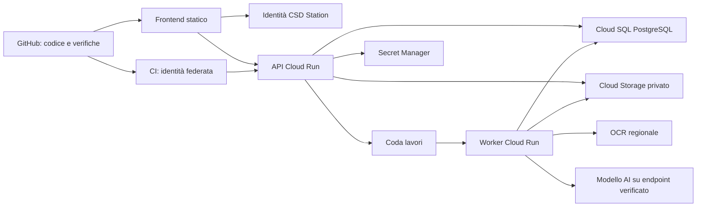

# Architettura e percorso GitHub → GCP

## Stato della consegna

Il progetto è un frontend statico locale con funzioni documentali effettive. Non è un SaaS notarile in produzione. Non sono stati creati repository remoti, progetti GCP, account, pagamenti o servizi AI. La cartella può essere inserita in un repository GitHub senza trasferire dati dei clienti.

La struttura mantiene il sistema visivo di CS Restaurant OS. Nessuna dipendenza è caricata da CDN, nessun font remoto, nessuna telemetria. Le due librerie PDF sono distribuite localmente con licenze. `pdf-lib` scrive i documenti; PDF.js li visualizza con valutazione dinamica dei contenuti disabilitata. I PDF rimangono in memoria nella scheda; solo note/configurazioni vengono salvate in localStorage.

## Componenti attuali

- `js/app.js`: shell CSD Station, navigazione per aree, le 12 pagine, Lo Studio (chat + documento), Otto globale, ricerca, dialoghi.
- `js/modules.js`: registro dei 12 moduli e delle 4 aree.
- `js/demo.js`: lo studio dimostrativo condiviso da tutti i moduli (persone, pratiche, email, chiamate, visure, termini, audit). Tutto inventato.
- `js/agent.js`: Otto. Scenari dimostrativi con il contratto `passaggi → risposta → documento → azioni` che il backend dovrà restituire; abbinamento dei campi PDF ai dati della pratica.
- `js/pdf-core.js`: ispezione AcroForm, compilazione, generazione del modulo dimostrativo. Originali mai sovrascritti.
- `js/store.js`: stato locale v2 (approvazioni, attività chiuse, notifiche), escaping.
- `css/style.css`, `css/otto.css`, `assets/csd-mark.svg`: riuso diretto di CS Restaurant OS. I componenti propri sono in `css/notaro.css`.
- `scripts/serve.mjs`, `scripts/build.mjs`: anteprima su loopback e build statica in `dist/`.

## Servizi proposti su GCP

Frontend su hosting statico/GitHub Pages se coerente con il dominio e l'identità, oppure dietro lo stesso dominio del backend. Con GitHub Pages: niente segreti nel JavaScript, niente cookie cross-site improvvisati, CORS ristretto al dominio preciso. Il repository resta il sistema di versionamento; non è il database.

Cloud SQL è il candidato per dati relazionali, osservazioni/versioni e ricerca filtrata. Il layer semantico è aggiuntivo; un database vettoriale da solo non sostituisce il modello di provenienza. Cloud Storage conserva originali e derivati, in oggetti immutabili indirizzati per ID/versione e hash. URL di download brevi e autorizzati. Il nome caricato dal cliente non diventa un percorso affidabile.

Scegliere regione, endpoint AI e servizi OCR dopo verifica della disponibilità e delle condizioni applicabili. Non assumere che europe-west1 del vecchio progetto risolva automaticamente tutti i requisiti. Logging senza corpi di documenti o prompt; metriche tecniche separate. Definire retention di originali, output, cache, code, backup e log. Il bucket operativo non è conservazione a norma.

## Modello del database di produzione

| Entità | Chiavi e contenuti | Invarianti |
| --- | --- | --- |
| tenant | ID studio, piano, stato | Il server deriva lo studio dall'identità verificata |
| membership / case_acl | utente, studio, ruolo, fascicolo | Permessi applicati prima di lettura, ricerca e generazione |
| case | studio, riferimento al gestionale, tipo, stato | Un riferimento esterno non è una relazione autorizzata automaticamente |
| entity | studio, tipo, attributi identificativi | Identità e omonimie non vengono risolte dall'AI in autonomia |
| case_entity | fascicolo, entità, ruolo | Le relazioni conservano contesto e validità |
| document / version | studio, fascicolo, hash, oggetto storage, MIME, pagine | Originale immutabile, nuova versione invece di sovrascrittura |
| observation | entità, chiave, valore raw/normalizzato, document_version, pagina, bbox, estrattore | Proposta distinta dal fatto approvato; pagina e bbox validate |
| resolution | gruppo osservazioni, osservazione scelta, revisore, data, motivazione | Concorrenza ottimistica; una nuova fonte può invalidare la revisione |
| template / version | hash PDF, campi nativi/geometrie, mappature | Una mappatura non si applica silenziosamente a un altro PDF |
| generated_output | template_version, resolution IDs, hash, stato | Riproducibilità e revisione prima del rilascio |
| job | studio, input versions, tipo, idempotency key, stato, consumo | Retry senza doppie generazioni/addebiti |
| audit_event | attore verificato, azione, oggetti, timestamp | Append-only lato servizio; niente testo dei documenti nei log |
| export | studio, schema version, oggetti, manifest hash, scadenza | Export autorizzato e test di ripristino |

Chiavi esterne composite con tenant_id impediscono riferimenti tra studi. Row Level Security come difesa aggiuntiva, usando un ruolo applicativo non proprietario e non superuser; contesto tenant impostato nella transazione e mai da un parametro cliente non verificato. Servono test negativi tra tenant e tra fascicoli. I job devono ripetere i controlli di autorizzazione, incluse revoche avvenute dopo l'accodamento.

## Contratti API da implementare

Tutti gli endpoint seguenti sono **progettati, non disponibili nel frontend attuale**.

| Operazione | Endpoint proposto | Controlli essenziali |
| --- | --- | --- |
| Workspace autorizzato | GET /v1/workspace | Identità, tenant, ruoli, entitlement server |
| Fascicoli | GET/POST /v1/cases | ACL e paginazione |
| Ingresso file | POST /v1/cases/:id/uploads | Dimensione, MIME reale, hash, quarantena, parser isolato |
| Estrazione | POST /v1/documents/:id/jobs | Versione, tipo lavoro, budget, idempotenza |
| Osservazioni | GET /v1/cases/:id/observations | Provenienza e stato, nessun dato senza ACL |
| Revisione | POST /v1/resolutions | Versione attesa, attore server, motivazione, audit |
| Compilazione | POST /v1/templates/:id/outputs | Solo valori approvati e non obsoleti; nessuna firma automatica |
| Chat | POST /v1/cases/:id/questions | Fonti selezionate e autorizzate, citazioni strutturate, astensione |
| Export | POST /v1/exports | Scope, formato, manifest, scadenza e audit |
| Consumo | GET /v1/usage | Pagine, token, storage, tetto di spesa |

Gli output AI devono essere validati contro uno schema, con enum e limiti. Un'istruzione dentro un PDF è contenuto, non autorizzazione a inviare email o cambiare dati. I metadati di citazione vengono verificati dal server. Nessun modello può dichiarare da solo una pratica corretta o conforme.

## Rilascio progressivo e criteri di accettazione

1. **Fondazione**: identità, tenant, ACL, storage, backup/ripristino, segreti, ambienti isolati, osservabilità e tetto di spesa. Test obbligatori di isolamento e revoca accessi.
2. **Verticale PDF**: corpus rappresentativo per campi multipagina, caratteri, checkbox/radio, scansioni, rotazioni e crop. Rifiuto esplicito di XFA, cifratura e firme quando non supportati. Fonti, revisioni e output tracciati.
3. **Estrazione e controllo**: dataset annotato dallo studio; valutare errori di pagina, entità e valore, non solo una percentuale complessiva. Non usare confidence inventate. Gestire code, cancellazione e retry.
4. **Assistente**: retrieval con ACL, versione delle fonti, citazioni apribili, risposta assente quando il dato manca; valutazioni di allucinazione, documenti ostili e conflitti.
5. **Connettori e SaaS**: accordi con fornitori, API documentate, consenso agli invii per singola azione, billing e controllo entitlements. Nessun scraping di gestionali presunto autorizzato.

## GitHub e deployment

La workflow `verify.yml` esegue sintassi, test e build senza installare pacchetti. `pages.yml` è manuale: pubblica solo `dist/`, quando l'utente avrà scelto un repository e abilitato GitHub Pages. La pubblicazione può rendere visibile il codice e l'interfaccia, mai i dati locali del browser.

Il Dockerfile e il manifest Nginx servono **solo il frontend** su porta 8080, compatibile come impostazione con Cloud Run. Non implementano il backend sopra descritto. Un'immagine non è stata costruita o distribuita in questo ambiente. Per il backend futuro usare Workload Identity Federation tra GitHub e GCP, service account a privilegi minimi e approvazioni dell'ambiente di produzione; nessuna chiave JSON nel repository.

Prima di un rilascio pubblico servono destinazione GitHub, progetto GCP, dominio e identità reali. Nessuna credenziale è stata cercata o copiata dai progetti precedenti.
